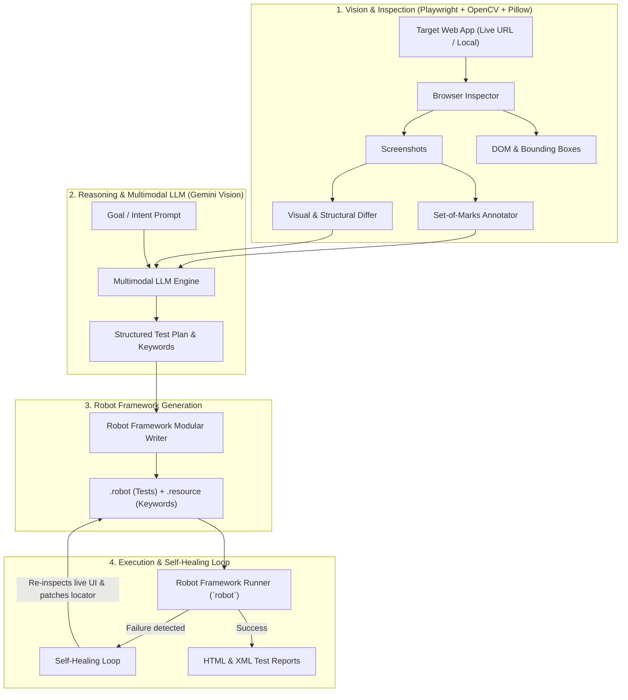

# Test Automation Agent (Robot Framework + Multimodal LLM)

[Versão em Português](README.pt-BR.md)

An autonomous, production-ready web test automation agent that:
1. **Evaluates visual and structural UI changes** between application versions (e.g. Production vs. Staging).
2. **Explores live web applications** autonomously driven by high-level natural language user goals.
3. **Applies multimodal computer vision** using the **Set-of-Marks (SoM)** technique to map interactive elements and compute resilient locators (`data-testid`, `id`, `text`).
4. **Dynamically generates idiomatic, modular Robot Framework suites** (`.robot` + `.resource`) powered by **Playwright** (`robotframework-browser`).
5. **Executes and Self-Heals tests automatically** in CI/CD pipelines when locators break or layouts change.

---

## 🛠️ System Architecture



---

## 🚀 Installation & Setup

### Prerequisites
- Python 3.10+
- Node.js 18+ (required by `robotframework-browser` Playwright backend)

### Step-by-Step Setup

```bash
# 1. Clone the repository and enter the folder
git clone https://github.com/your-username/test-automation-agent.git
cd test-automation-agent

# 2. Create and activate a virtual environment
python3 -m venv .venv
source .venv/bin/activate

# 3. Install Python dependencies
pip install -r requirements.txt

# 4. Initialize Robot Framework Browser and install Playwright Chromium
rfbrowser init --skip-browsers
playwright install chromium

# 5. Install the package in editable mode (registers the 'agent-rf' CLI command)
pip install -e . --no-build-isolation --no-deps
```

### LLM API Key Configuration
To enable multimodal vision reasoning for complex web pages:
```bash
export GEMINI_API_KEY="your_api_key_from_google_ai_studio"
```
*(Note: When no API key is provided, the agent runs in **intelligent offline heuristic mode** with 100% core capability, making it fully operational in private environments and air-gapped CI/CD systems).*

---

## 💻 How to Run the Project

The tool provides an intuitive CLI (`agent-rf`) that can test **real live websites (`https://...`)**, **local dev servers (`http://localhost:...`)**, and **offline files**:

### CLI Flags at a Glance
| Flag | Description | Default |
| :--- | :--- | :---: |
| `--run / --no-run` | Automatically executes the generated suite with Robot Framework | `--run` |
| `--heal / --no-heal` | Activates self-healing loop on execution failures | `--heal` |
| `--headed / --headless` | Opens a visible browser window on your desktop to watch interactions live | `--headless` |
| `--output-dir, -o` | Directory where suites, logs, and screenshots are saved | `./generated_tests` |

---

## 🎯 Real-World Use Cases & Examples

### Use Case 1: Intent-Driven E2E Test Generation (`explore`)
Generate production-ready test suites for a user flow by simply stating what you want to test in plain English or Portuguese.

```bash
# Example against a live SaaS / E-commerce site:
agent-rf explore https://example.com/login \
  --intent "Enter credentials, click Sign In, and verify dashboard navigation" \
  --output-dir ./tests_login \
  --run

# Want to watch the browser interact live on your monitor? Add --headed:
agent-rf explore https://example.com/checkout \
  --intent "Add product to cart, fill discount coupon, and complete checkout" \
  --headed
```

**What the agent does:**
1. Navigates to the live site via Playwright (waiting for SPAs / network idle).
2. Captures full-page screenshots and labels all interactive elements with high-contrast numbered badges (**Set-of-Marks**).
3. Prompts the multimodal LLM to reason over the visual UI and produce keywords and test scenarios.
4. Generates modular `.robot` and `.resource` files and executes them with Robot Framework.

---

### Use Case 2: Visual & Structural Regression Testing Across Environments (`diff`)
The ideal CI/CD pre-deployment check: **compare Production vs. Staging/Preview** before releasing a new version.

```bash
# Compare Production with a Staging / Pull Request preview environment:
agent-rf diff \
  https://app.mycompany.com \
  https://staging.mycompany.com \
  --output-dir ./regression_suite \
  --run
```

**What the agent does:**
1. Inspects both environments side-by-side.
2. Generates a **visual diff heatmap** image highlighting changed visual regions (buttons shifted, new banners, updated layout).
3. Performs a structural DOM diff identifying added fields, removed components, and altered labels.
4. Dynamically writes and runs Robot Framework regression tests verifying both the new features and existing user flows.

---

### Use Case 3: Autonomous Self-Healing for Broken Locators in CI/CD (`run --heal`)
When front-end developers update IDs, CSS classes, or button wrappers, automated test suites often break (flaky tests). The agent self-heals broken locators without human intervention.

```bash
agent-rf run ./tests_login/suite_login.robot \
  --url https://app.mycompany.com/login \
  --heal
```

**What the agent does:**
1. Executes the test suite and detects locator failures in `output.xml`.
2. Automatically triggers the healing engine: re-inspects the live webpage at the moment of failure.
3. Maps current elements, identifies where the target element moved or what its new locator is, and patches the `.resource` keyword file.
4. Re-executes the test and marks the build as passed.

---

### Use Case 4: Visual UI Auditing & Set-of-Marks Mapping (`inspect`)
Audit any web page to inspect its interactive elements, coordinate boundaries, and candidate locators.

```bash
agent-rf inspect https://example.com --output-dir ./audit_result
```
Outputs:
- `annotated_view.png`: Visual screenshot labeled with Set-of-Marks badges (`[1]`, `[2]`, ...).
- Markdown table in terminal with tags, `data-testid`, IDs, text, and prioritized locators.

---

### Running the Built-in Demo Application
The repository includes a two-version local demo app (`demo_app/v1` baseline and `demo_app/v2` with promotions, modals, and new fields):

```bash
# 1. Run visual diff against the demo application:
agent-rf diff \
  "file://$(pwd)/demo_app/v1/index.html" \
  "file://$(pwd)/demo_app/v2/index.html" \
  --output-dir ./demo_diff_results \
  --headed

# 2. Run exploratory testing on demo app:
agent-rf explore \
  "file://$(pwd)/demo_app/v1/index.html" \
  --intent "Fill username, select professional plan, and submit order" \
  --headed
```

---

## 🧪 Unit Tests & Code Coverage

The repository maintains strict test coverage enforced via `pytest-cov` and CI checks:

```bash
# Run test suite with coverage report (fails if below 80%):
pytest
```
- **19 unit tests passing**
- **91.82% code coverage**

---

## ⚙️ CI/CD Pipeline (GitHub Actions)

A complete workflow is configured at `.github/workflows/ci.yml`:
- **Matrix testing**: Python `3.11` and `3.12` on `ubuntu-latest`.
- **Browser caching**: Caches Playwright Chromium and Node modules.
- **Coverage enforcement**: Validates `--cov-fail-under=80`.
- **End-to-End smoke tests**: Runs `agent-rf diff` and `agent-rf inspect` on every push and pull request.

---

## 📊 Reports & Artifacts

After execution, standard Robot Framework reports and evidence are available in `results/`:
- `report.html`: High-level executive test metrics and pass/fail summary.
- `log.html`: Detailed execution log with keyword call trees, timestamps, and failure traces.
- `output.xml`: Machine-readable XML report for CI/CD integrations.
- `evidencia_*.png`: High-resolution evidence screenshots captured during test runs.

---

## 📄 License
MIT License.
