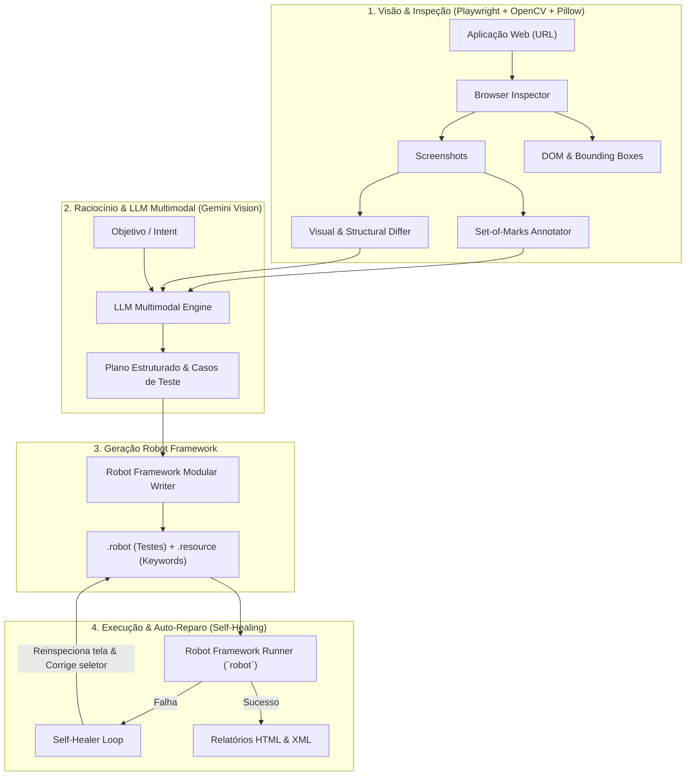

# Agente de Automação de Testes (Robot Framework + LLM Multimodal)

Uma ferramenta inteligente e autônoma de automação de testes web que:
1. **Avalia mudanças visuais e estruturais** na interface da aplicação (Baseline vs Versão Atualizada).
2. **Explora telas autonomamente** a partir de objetivos em linguagem natural.
3. **Aplica visão computacional multimodal** com a técnica **Set-of-Marks (SoM)** para identificar elementos interativos e calcular seletores robustos.
4. **Gera dinamicamente scripts modulares em Robot Framework** (`.robot` + `.resource`) utilizando a moderna biblioteca **Playwright** (`robotframework-browser`).
5. **Executa e auto-repara (Self-Healing)** os testes automaticamente em caso de quebra de seletores ou mudanças de layout.

---

## 🛠️ Arquitetura do Sistema



---

## 🚀 Instalação e Configuração

### Pré-requisitos
- Python 3.10+
- Node.js 18+ (para o backend do Playwright do `robotframework-browser`)

### Configuração do Ambiente

```bash
# 1. Crie e ative o ambiente virtual
python3 -m venv .venv
source .venv/bin/activate

# 2. Instale as dependências
pip install -r requirements.txt

# 3. Inicialize o backend do Robot Framework Browser
rfbrowser init --skip-browsers
playwright install chromium

# 4. Instale o pacote local no modo editável
pip install -e . --no-build-isolation --no-deps
```

### Configuração de API (Opcional para Gemini Vision)
Se desejar utilizar os modelos de visão multimodal da nuvem (Gemini), defina a chave de API:
```bash
export GEMINI_API_KEY="sua_chave_aqui"
```
*(Nota: O agente possui um gerador heurístico inteligente integrado que funciona 100% offline mesmo sem chave de API).*

---

## 💻 Como Usar (CLI `agent-rf`)

### 1. Modo Comparação Visual (Diff & Testes de Regressão)
Compara a versão baseline com uma versão atualizada da aplicação, destaca as alterações visuais (bounding boxes/heatmap) e gera testes de regressão dinamicamente:

```bash
agent-rf diff \
  file:///caminho/demo_app/v1/index.html \
  file:///caminho/demo_app/v2/index.html \
  --output-dir ./generated_tests/diff_suite \
  --run
```

### 2. Modo Exploratório Orientado a Intenção
Forneça a URL e um objetivo em linguagem natural. O agente mapeia a tela com marcadores visuais (Set-of-Marks) e gera a suíte completa:

```bash
agent-rf explore \
  file:///caminho/demo_app/v1/index.html \
  --intent "Preencher dados do cliente, selecionar plano profissional e submeter pedido" \
  --output-dir ./generated_tests/explore_suite \
  --run
```

### 3. Execução com Auto-Recuperação (Self-Healing)
Executa uma suíte de teste existente com diagnóstico e correção automática de seletores em caso de falha:

```bash
agent-rf run ./tests/demo_healing/broken_suite.robot \
  --url file:///caminho/demo_app/v1/index.html \
  --heal
```

### 4. Inspeção e Mapeamento Visual
Inspeciona uma página e gera o screenshot com as marcações *Set-of-Marks* e a tabela de seletores candidatos:

```bash
agent-rf inspect file:///caminho/demo_app/v1/index.html --output-dir ./inspection_output
```

---

## 🧪 Estrutura dos Testes Gerados

Seguindo as melhores práticas do Robot Framework, os testes são divididos em:
- **`suíte.robot`**: Foco em legibilidade e regras de negócio de alto nível.
- **`resources/suíte.resource`**: Keywords de página, ações granulares no navegador (`New Page`, `Click`, `Fill Text`, `Get Text`, `Take Screenshot`) e variáveis de seletores (`data-testid`, `id`, `text`).

---

## 📊 Relatórios e Evidências
Após a execução de qualquer comando, o Robot Framework gera automaticamente no diretório `results/`:
- `report.html`: Visão executiva dos testes e métricas de aprovação.
- `log.html`: Log detalhado com todos os passos, parâmetros e capturas de tela (*screenshots*).
- `output.xml`: Resultados em XML para integração contínua (CI/CD).

