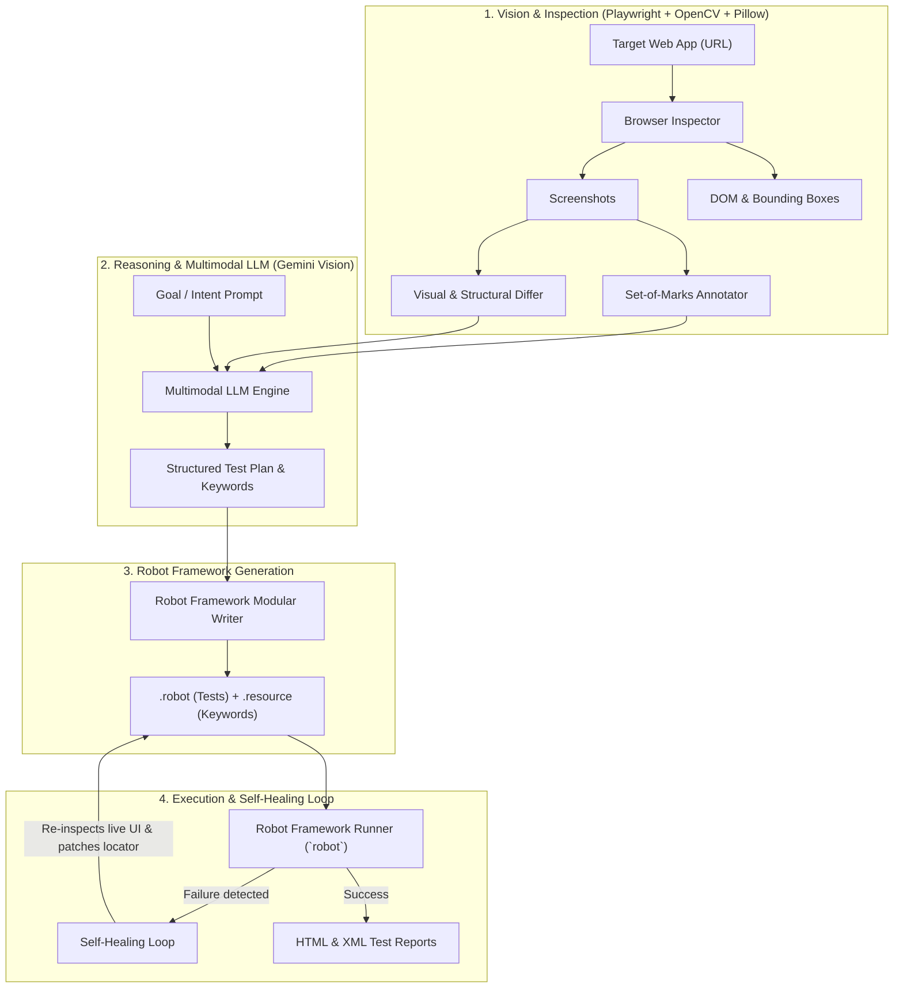

# Test Automation Agent (Robot Framework + Multimodal LLM)

[Versão em Português](README.pt-BR.md)

An autonomous, intelligent web test automation tool that:
1. **Evaluates visual and structural UI changes** between application versions (Baseline vs. Updated release).
2. **Explores interfaces autonomously** driven by high-level natural language user goals.
3. **Applies multimodal computer vision** using the **Set-of-Marks (SoM)** technique to map interactive elements and compute resilient locators.
4. **Dynamically generates idiomatic, modular Robot Framework suites** (`.robot` + `.resource`) powered by **Playwright** (`robotframework-browser`).
5. **Executes and Self-Heals tests automatically** when locators break or UI layouts shift.

---

## 🛠️ System Architecture



---

## 🚀 Installation & Setup

### Prerequisites
- Python 3.10+
- Node.js 18+ (required by `robotframework-browser` Playwright backend)

### Environment Setup

```bash
# 1. Create and activate virtual environment
python3 -m venv .venv
source .venv/bin/activate

# 2. Install dependencies
pip install -r requirements.txt

# 3. Initialize Robot Framework Browser backend and Chromium
rfbrowser init --skip-browsers
playwright install chromium

# 4. Install the package in editable mode
pip install -e . --no-build-isolation --no-deps
```

### API Key Configuration (Optional for Cloud Gemini Vision)
If you want to use cloud-hosted multimodal models (Gemini), export your API key:
```bash
export GEMINI_API_KEY="your_api_key_here"
```
*(Note: The agent includes an intelligent offline heuristic engine that runs with 100% functionality and zero external dependencies when no API key is provided).*

---

## 💻 How to Use (`agent-rf` CLI)

### 1. Visual Difference & Regression Mode (`diff`)
Compares a baseline version with an updated release, highlights visual shifts with heatmaps/bounding boxes, and dynamically generates regression tests covering new and modified elements:

```bash
agent-rf diff \
  file:///path/to/demo_app/v1/index.html \
  file:///path/to/demo_app/v2/index.html \
  --output-dir ./generated_tests/diff_suite \
  --run
```

### 2. Intent-Driven Exploratory Mode (`explore`)
Provide a target URL and a natural language goal. The agent maps the screen with numbered visual markers (Set-of-Marks) and generates a complete end-to-end test suite:

```bash
agent-rf explore \
  file:///path/to/demo_app/v1/index.html \
  --intent "Fill in user details, select professional plan, and submit order" \
  --output-dir ./generated_tests/explore_suite \
  --run
```

### 3. Execution with Self-Healing (`run`)
Runs an existing test suite with automated failure diagnosis and locator self-repair:

```bash
agent-rf run ./tests/demo_healing/broken_suite.robot \
  --url file:///path/to/demo_app/v1/index.html \
  --heal
```

### 4. Visual Inspection & Locator Mapping (`inspect`)
Inspects any webpage, produces a Set-of-Marks annotated screenshot, and outputs a candidate locators table:

```bash
agent-rf inspect file:///path/to/demo_app/v1/index.html --output-dir ./inspection_output
```

---

## 🧪 Structure of Generated Tests

Adhering to Robot Framework and Page Object best practices, generated suites are cleanly separated into:
- **`suite.robot`**: Focuses on high-level, human-readable business scenarios and test cases.
- **`resources/suite.resource`**: Contains granular UI keywords (`New Page`, `Click`, `Fill Text`, `Get Text`, `Take Screenshot`) and resilient locator variables (`data-testid`, `id`, `text`).

---

## 📊 Reports & Visual Artifacts
After test execution, standard Robot Framework reports and screenshots are generated in `results/`:
- `report.html`: High-level executive test metrics and summary.
- `log.html`: In-depth execution log with step-by-step keyword parameters and evidence screenshots.
- `output.xml`: Machine-readable XML report for CI/CD pipelines.

---

## 📄 License
MIT License.
