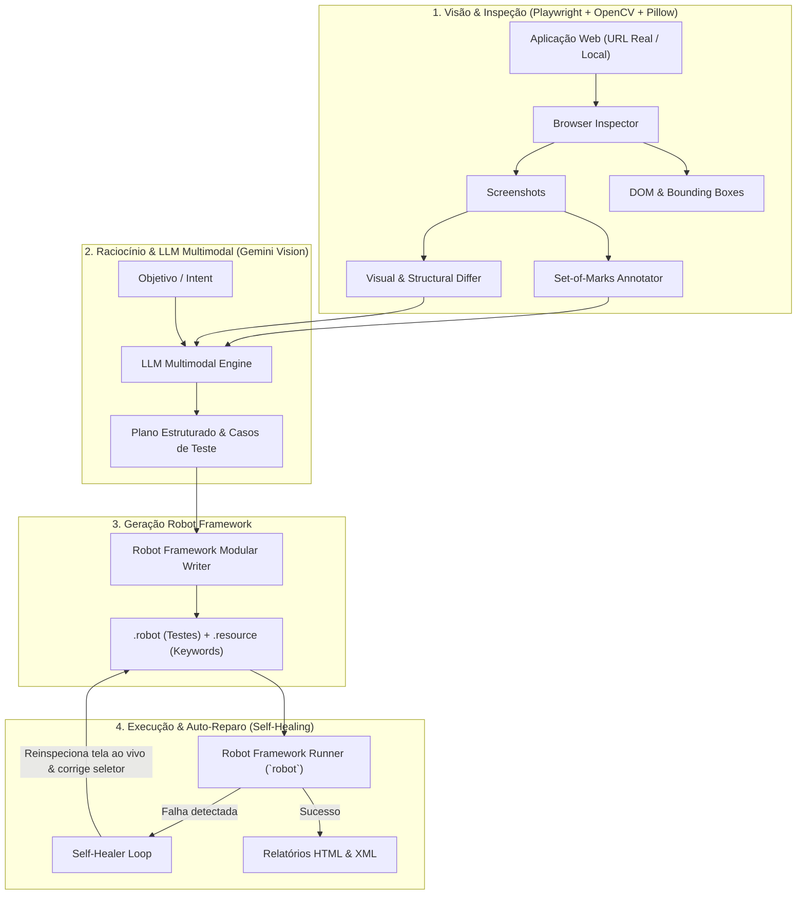

# Agente de Automação de Testes (Robot Framework + LLM Multimodal)

[Read in English](README.md)

Um agente autônomo de automação de testes web pronto para produção que:
1. **Avalia mudanças visuais e estruturais** na interface entre versões da aplicação (ex: Produção vs. Staging).
2. **Explora aplicações web reais autonomamente** a partir de objetivos fornecidos em linguagem natural.
3. **Aplica visão computacional multimodal** com a técnica **Set-of-Marks (SoM)** para mapear elementos interativos e calcular seletores robustos (`data-testid`, `id`, `text`).
4. **Gera dinamicamente scripts modulares em Robot Framework** (`.robot` + `.resource`) utilizando a biblioteca **Playwright** (`robotframework-browser`).
5. **Executa e auto-repara (Self-Healing)** os testes automaticamente em pipelines de CI/CD quando seletores quebram ou layouts sofrem alterações.

---

## 🛠️ Arquitetura do Sistema



---

## 🚀 Instalação e Configuração

### Pré-requisitos
- Python 3.10+
- Node.js 18+ (necessário para o backend do Playwright no `robotframework-browser`)

### Passo a Passo de Instalação

```bash
# 1. Clone o repositório e acesse a pasta
git clone https://github.com/seu-usuario/test-automation-agent.git
cd test-automation-agent

# 2. Crie e ative o ambiente virtual
python3 -m venv .venv
source .venv/bin/activate

# 3. Instale as dependências Python
pip install -r requirements.txt

# 4. Inicialize o backend do Robot Framework Browser e baixe o Chromium do Playwright
rfbrowser init --skip-browsers
playwright install chromium

# 5. Instale o pacote em modo editável (registra o comando CLI 'agent-rf')
pip install -e . --no-build-isolation --no-deps
```

### Configuração da Chave de API do LLM
Para habilitar o raciocínio visual multimodal em páginas web complexas:
```bash
export GEMINI_API_KEY="sua_chave_do_google_ai_studio"
```
*(Nota: Quando nenhuma chave de API é fornecida, o agente opera em **modo heurístico inteligente offline** com 100% das funcionalidades ativas, operando perfeitamente em redes privadas e ambientes isolados de CI/CD).*

---

## 💻 Como Rodar o Projeto

A ferramenta fornece a CLI `agent-rf`, capaz de testar **sites reais na internet (`https://...`)**, **servidores locais de desenvolvimento (`http://localhost:...`)** e **páginas locais**:

### Parâmetros da CLI em Destaque
| Parâmetro | Descrição | Padrão |
| :--- | :--- | :---: |
| `--run / --no-run` | Executa automaticamente a suíte gerada com o Robot Framework | `--run` |
| `--heal / --no-heal` | Ativa o ciclo de auto-recuperação em caso de falha | `--heal` |
| `--headed / --headless` | Abre uma janela visível do navegador na sua tela para acompanhar a execução | `--headless` |
| `--output-dir, -o` | Diretório onde os testes, logs e capturas de tela serão salvos | `./generated_tests` |

---

## 🎯 Casos de Uso Reais e Exemplos

### Caso de Uso 1: Geração de Testes E2E Orientada a Intenção (`explore`)
Gere suítes completas de teste para um fluxo de usuário descrevendo o que deseja validar em português ou inglês:

```bash
# Exemplo em um e-commerce ou SaaS real na web:
agent-rf explore https://example.com/login \
  --intent "Digitar credenciais de teste, clicar em Entrar e validar que o painel principal foi carregado" \
  --output-dir ./testes_login \
  --run

# Deseja ver o navegador clicando e digitando na sua tela? Adicione --headed:
agent-rf explore https://example.com/checkout \
  --intent "Adicionar produto ao carrinho, aplicar cupom de desconto e finalizar pedido" \
  --headed
```

**O que o agente faz:**
1. Navega até o site real via Playwright (aguardando carregamentos assíncronos e SPAs).
2. Captura screenshot da página e etiqueta cada elemento interativo com marcadores numéricos (**Set-of-Marks**).
3. Aciona o LLM multimodal para analisar a interface e propor keywords e cenários de teste.
4. Gera arquivos modulares `.robot` e `.resource` e os executa via Robot Framework.

---

### Caso de Uso 2: Validação de Deploy e Regressão Visual entre Ambientes (`diff`)
O cenário ideal de validação pré-deploy em CI/CD: **comparar Produção vs. Staging/Preview** antes de liberar um novo release.

```bash
# Compara o ambiente de Produção com a nova versão em Staging:
agent-rf diff \
  https://app.minhaempresa.com.br \
  https://staging.minhaempresa.com.br \
  --output-dir ./suite_regressao \
  --run
```

**O que o agente faz:**
1. Inspeciona os dois ambientes simultaneamente.
2. Gera um mapa visual (*heatmap*) destacando mudanças de layout, botões reposicionados ou novos banners.
3. Realiza a comparação do DOM identificando novos campos, modais adicionados ou elementos removidos.
4. Gera e executa testes de regressão dinâmicos garantindo que as novidades funcionem e os fluxos existentes continuem íntegros.

---

### Caso de Uso 3: Auto-Recuperação de Seletores Quebrados em CI/CD (`run --heal`)
Quando o time de front-end altera IDs, classes CSS ou a estrutura de um botão, testes automatizados costumam quebrar (*flaky tests*). O agente corrige seletores quebrados sem intervenção humana imediata:

```bash
agent-rf run ./testes_login/suite_login.robot \
  --url https://app.minhaempresa.com.br/login \
  --heal
```

**O que o agente faz:**
1. Executa a suíte e intercepta a falha do seletor no `output.xml`.
2. Dispara o loop de auto-recuperação: re-inspeciona a página ao vivo no momento exato do erro.
3. Descobre onde o elemento foi parar ou qual é o seu novo locator e aplica o patch diretamente no arquivo `.resource`.
4. Reexecuta a suíte e aprova a execução com sucesso.

---

### Caso de Uso 4: Auditoria Visual e Mapeamento Set-of-Marks (`inspect`)
Inspecione qualquer página web para auditar elementos interativos, caixas delimitadoras (*bounding boxes*) e seletores recomendados:

```bash
agent-rf inspect https://example.com --output-dir ./auditoria_resultado
```
Arquivos gerados:
- `annotated_view.png`: Screenshot com marcações numéricas Set-of-Marks (`[1]`, `[2]`, ...).
- Tabela no terminal contendo tags, `data-testid`, IDs, textos visíveis e seletores recomendados.

---

### Executando com a Aplicação de Demonstração Integrada
O repositório já inclui uma aplicação de demonstração com duas versões (`demo_app/v1` baseline e `demo_app/v2` com novos modais, campos de cupom e redesign):

```bash
# 1. Comparação visual na aplicação demo com navegador visível:
agent-rf diff \
  "file://$(pwd)/demo_app/v1/index.html" \
  "file://$(pwd)/demo_app/v2/index.html" \
  --output-dir ./demo_diff_results \
  --headed

# 2. Exploração orientada a objetivo na aplicação demo:
agent-rf explore \
  "file://$(pwd)/demo_app/v1/index.html" \
  --intent "Preencher usuário, selecionar plano profissional e submeter pedido" \
  --headed
```

---

## 🧪 Testes Unitários e Cobertura de Código

O repositório mantém cobertura rigorosa de código validada via `pytest-cov` e CI:

```bash
# Executa os testes unitários (falha se cobertura for inferior a 80%):
pytest
```
- **19 testes unitários aprovados**
- **91.82% de cobertura de código**

---

## ⚙️ Pipeline de Integração Contínua (GitHub Actions)

Configurado em `.github/workflows/ci.yml`:
- **Matriz de ambientes**: Python `3.11` e `3.12` sobre `ubuntu-latest`.
- **Cache de navegadores**: Cache persistente de dependências Node e Playwright Chromium.
- **Validação de cobertura**: Trava de qualidade mandatória com `--cov-fail-under=80`.
- **Smoke test ponta a ponta**: Executa `agent-rf diff` e `agent-rf inspect` em todos os pushes e pull requests.

---

## 📊 Relatórios e Artefatos Gerados

Após a execução, os relatórios padronizados do Robot Framework ficam disponíveis em `results/`:
- `report.html`: Métricas executivas dos testes e resumo de aprovação.
- `log.html`: Log minucioso com a árvore de execução, parâmetros e evidências.
- `output.xml`: Relatório legível por máquina para integração com ferramentas de CI/CD.
- `evidencia_*.png`: Screenshots em alta resolução capturados durante os testes.

---

## 📄 Licença
Licença MIT.
